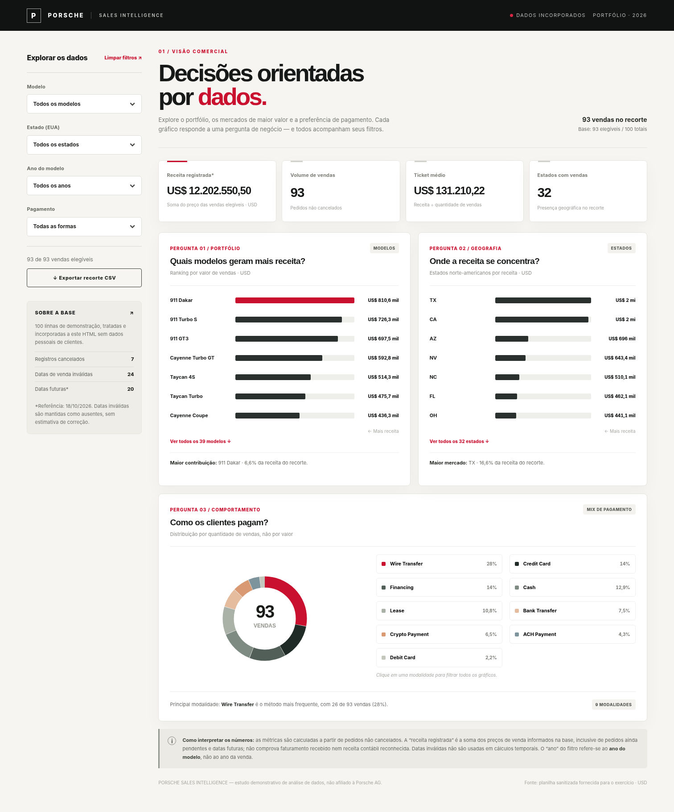
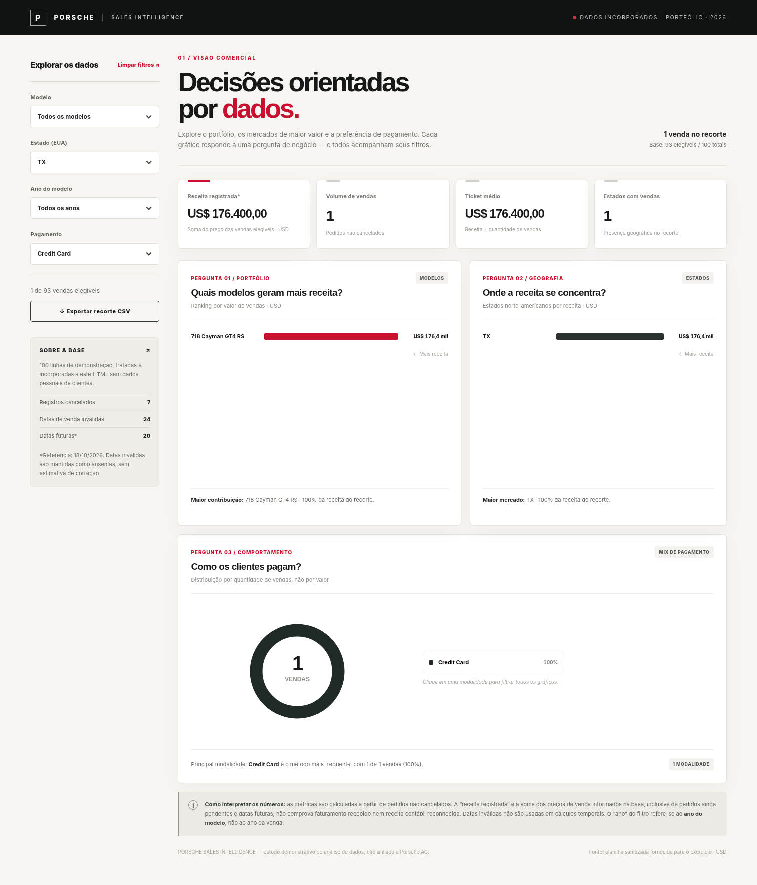
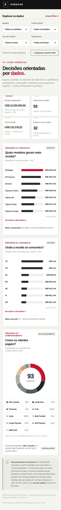

# Porsche Sales Intelligence

**Dashboard interativa de análise comercial | HTML, CSS e JavaScript | Portfólio de análise de dados**

> **Status:** aplicação concluída e testada localmente. **A publicação no GitHub Pages ainda precisa ser ativada** na conta do proprietário deste repositório. As imagens abaixo demonstram a execução local, não um site já publicado.



## Objetivo

Transformar uma planilha sanitizada de 100 registros demonstrativos de vendas da Porsche em uma dashboard para responder **três perguntas de negócio**, com KPIs e filtros interativos. O projeto usa apenas **um arquivo HTML independente** para a aplicação: estilos, lógica e registros tratados estão embutidos em `index.html`.

### Três perguntas de negócio

| Pergunta | Visualização | Por que importa? |
| --- | --- | --- |
| **1. Quais modelos geram mais receita?** | Ranking horizontal da soma de preços por modelo | Ajuda a identificar quais veículos concentram o valor do portfólio. |
| **2. Em quais estados a receita se concentra?** | Ranking por estado (EUA) | Destaca a distribuição geográfica do valor de pedidos/vendas registrados. |
| **3. Como os clientes pagam?** | Gráfico de rosca e legenda de participação por **quantidade**, não valor | Mostra a frequência relativa das modalidades de pagamento. |

Os quatro filtros — **modelo, estado, ano do modelo e método de pagamento** — funcionam simultaneamente e atualizam todos os resultados. Também é possível clicar nas barras ou modalidades de pagamento para filtrar, limpar todos os filtros e exportar o recorte para CSV.

## Indicadores principais

**Visão geral dos dados elegíveis** (sem aplicar filtros adicionais):

| Indicador | Resultado |
| --- | ---: |
| Registros na base | 100 |
| Registros cancelados, excluídos do cálculo | 7 |
| Registros elegíveis | **93** |
| Soma dos preços de venda dos registros elegíveis | **US$ 12.202.550,50** |
| Ticket médio | **US$ 131.210,22** |
| Estados com vendas elegíveis | **32** |
| Datas de venda inválidas/ausentes | 24 |
| Datas de venda futuras em relação a 18/10/2026 | 20 |

**Nota de interpretação:** a soma de preços é um *indicador comercial descritivo*, não receita contábil reconhecida nem valor efetivamente recebido. A base inclui registros com entrega pendente/em trânsito e datas futuras. O campo **ano** utilizado no filtro representa o **ano do modelo do veículo**, não o ano da transação.

## Evidências de funcionamento

### Sem filtros


### Filtros aplicados: TX + Credit Card

Ao selecionar **TX** no filtro de estado e **Credit Card** no filtro de pagamento, o recorte contém **1 registro** com valor de **US$ 176.400**.



### Visualização em celular



Testes automatizados locais com navegador Chromium/Playwright verificaram: carregamento sem erros JavaScript, indicadores iniciais, mudanças nos KPIs com dois filtros, limpeza de filtros, filtragem ao clicar numa barra, gráfico de pagamento e ausência de rolagem horizontal a 390 px de largura.

## Metodologia e tratamento da base

**Origem:** `Planilha base Porsche (sanitizada).xlsx`, fornecida para o exercício. A versão de publicação contém **somente 11 campos considerados não pessoais**, exportados para `data/porsche_sales_clean.csv` e embutidos em `index.html`:

`sale_id`, `sale_date`, `porsche_model`, `model_year`, `sale_price_usd`, `vehicle_mileage_mi`, `payment_method`, `city`, `state`, `delivery_status`, `date_valid`.

Os preços e anos foram convertidos para números, as datas inválidas ficaram vazias (`null` no HTML), os campos de análise foram padronizados e os cancelamentos foram preservados na base para transparência, mas **excluídos do cálculo**. Dados pessoais de clientes ou vendedores não foram incluídos. Não há fórmulas do Excel, backend, API, bibliotecas externas nem chave de acesso no HTML.

Tratamento completo, regras de qualidade e limitações: [docs/TRATAMENTO.md](docs/TRATAMENTO.md).

## Ferramentas, prompt e refinamentos

- **Tratamento:** planilha sanitizada disponibilizada no exercício, com preparação adicional para uso na dashboard.
- **Construção:** ChatGPT gerando HTML, CSS e JavaScript diretamente e apoiando a verificação local da interface. **Não foi usado o antigo Canvas e não foi criado um agente com skill nesta versão.**
- **Gráficos:** CSS e SVG nativos, sem dependências externas.
- **Testes:** Playwright/Chromium em ambiente local.
- **Publicação prevista:** GitHub Pages (site estático).

O pedido que deu origem ao trabalho e o **prompt final reconstituído**, além das decisões/refinamentos que passaram a fazer parte da especificação, estão em [docs/PROMPTS.md](docs/PROMPTS.md). Esse documento não apresenta uma transcrição fictícia de várias iterações de chat.

## Estrutura do repositório

```text
porsche-sales-dashboard/
├── index.html                       # Dashboard autônoma, com os dados dentro do HTML
├── README.md                        # Explicação do projeto, metodologia e evidências
├── .nojekyll                        # Publicação simples no GitHub Pages
├── data/
│   └── porsche_sales_clean.csv     # 100 registros, apenas colunas aprovadas
├── docs/
│   ├── PROMPTS.md                   # Especificação, decisões e refinamentos
│   └── TRATAMENTO.md                # Tratamento, regras, ressalvas e dicionário
├── scripts/
│   └── update_dashboard.py          # Substitui os dados embutidos pelo CSV tratado
└── assets/
    ├── dashboard-completa.png
    ├── dashboard-filtrada.png
    └── dashboard-mobile.png
```

## Executar a dashboard

Abra **`index.html` diretamente no navegador**. Não é necessário Python, Node.js, servidor web, instalação de pacotes nem conexão com a internet para visualizar os gráficos.

Opcionalmente, para conferir o CSV e atualizar o HTML após substituir a base por **outro CSV com as mesmas 11 colunas**:

```bash
python scripts/update_dashboard.py
```

O script valida os campos esperados e os tipos antes de substituir os dados no HTML. Ele não sanitiza planilhas cruas contendo informações sensíveis: **a sanitização deve ocorrer ANTES de publicar**.

## Publicar com GitHub Pages

> Crie um repositório **público** chamado `porsche-sales-dashboard` em sua conta. Caso você use outro nome, substitua-o em todas as referências abaixo.

1. Em [github.com/new](https://github.com/new), crie `porsche-sales-dashboard`, **Public**, preferencialmente sem gerar README adicional.
2. No terminal, dentro da pasta que contém `index.html`, execute (com o seu próprio login GitHub):

   ```bash
   git init
   git branch -M main
   git add .
   git commit -m "feat: create Porsche sales dashboard"
   git remote add origin https://github.com/narallencar/porsche-sales-dashboard.git
   git push -u origin main
   ```

   Alternativamente, envie os arquivos e pastas pela interface do GitHub, preservando os caminhos.

3. No repositório: **Settings → Pages → Build and deployment → Deploy from a branch**; escolha **`main`** e **`/(root)`**, e clique em **Save**.
4. Aguarde a primeira publicação e abra a URL indicada pelo GitHub Pages. Confirme que os quatro filtros funcionam no endereço publicado.
5. Só depois de conferir o site, troque a indicação abaixo pelo URL validado e retire o aviso de **publicação pendente** no topo do README.

**Endereço esperado após a publicação (AINDA NÃO VERIFICADO):** `https://narallencar.github.io/porsche-sales-dashboard/`

**URL de repositório prevista, para submissão (somente depois de criar):** `https://github.com/narallencar/porsche-sales-dashboard`

**Importante:** o link de entrega é o **do repositório**; o link do GitHub Pages demonstra o site funcionando.

## Limitações e próximos passos

- A base contém **dados demonstrativos** e datas futuras; as análises não representam faturamento real auditado.
- A seleção de estado usa siglas americanas, pois as cidades/estados na planilha são dos EUA.
- Uma próxima versão poderia filtrar transações por **ano da venda**, quando as datas forem válidas e o tratamento temporal estiver resolvido.
- Outra evolução seria comparar os resultados do ChatGPT com um agente especializado em tratamento de dados e design de dashboards.

*Projeto educacional independente, sem afiliação oficial à Porsche AG.*
